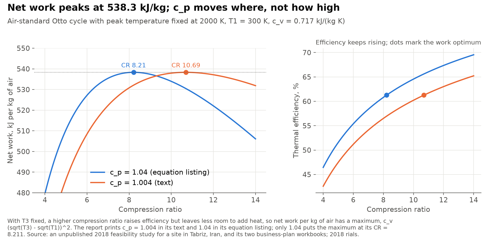
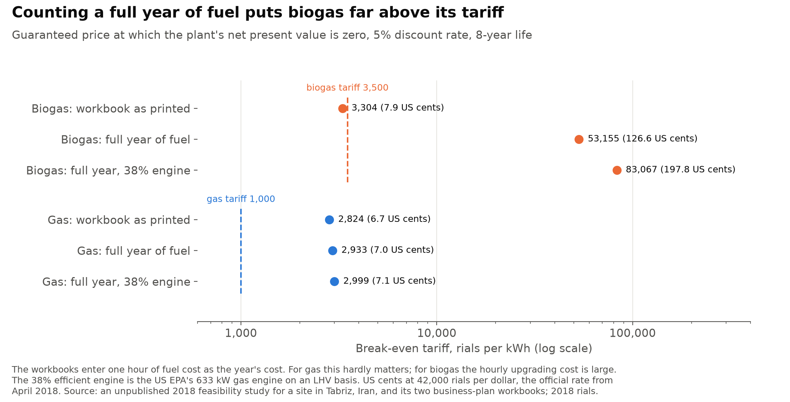
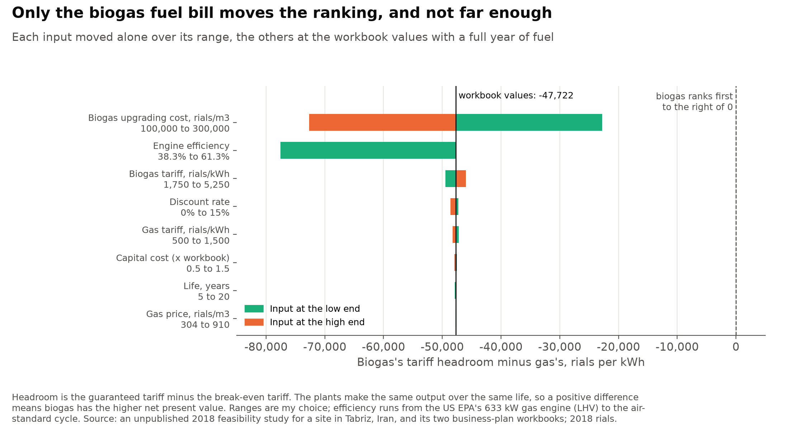
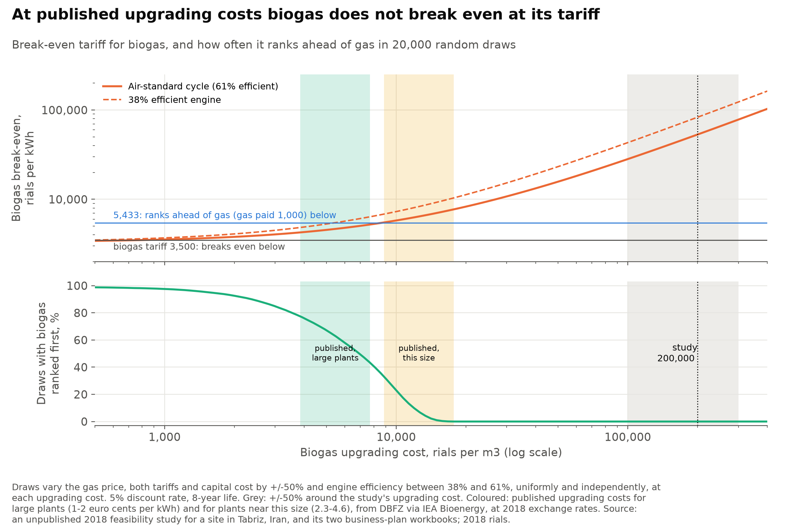

# At what guaranteed price does a small gas engine break even on natural gas or on biogas?

In 2018 the regional electricity company in East Azerbaijan, Iran, offered a guaranteed 1,000 rials per kWh for electricity made from natural gas and 3,500 rials for electricity made from biogas. An unpublished 2018 feasibility study for a site in Tabriz, Iran, compared a 538 kW combined heat and power engine run on pipeline gas with the same engine run on upgraded biogas from the city's wastewater. It concluded that the gas plant would not break even at 1,000 rials and that biogas, though it needs more fuel by volume, was the better investment because of its higher tariff.

This project rebuilds the study's engine model and the cash flows in its two business-plan workbooks, checks both, compares the biogas costs with published figures, and asks how much the ranking depends on fuel prices, efficiency and capital cost.

**Short answer:** neither fuel pays at its guaranteed price. The study's finding for biogas came from counting one hour of fuel cost as a year's.
- **Gas needs about 2,930 rials per kWh:** the break-even tariff is 2,933 rials (7.0 US cents at the 2018 official rate), against the 1,000 on offer. Running costs alone come to 1,770 rials per kWh. The study is right that gas does not break even.
- **The study's biogas result rests on one hour of fuel:** the report works out the *hourly* cost of upgrading the biogas, 125.52 m3 an hour at 200,000 rials per m3 (p. 54). The business plans then enter that hourly figure as the year's fuel cost. As printed, biogas breaks even at 3,304 rials per kWh, below its 3,500 tariff. With all 7,680 hours counted, it needs 53,155.
- **The study's upgrading price is also far above published costs:** 200,000 rials per m3 is about 52 euro cents per kWh of gas. Published estimates are 1 to 2 cents at large upgrading plants and about 2.3 to 4.6 cents at plants near this one's size (DBFZ, for IEA Bioenergy).
- **At published costs biogas still does not break even:** it would need upgrading under 811 rials per m3, about 0.2 cents per kWh. It ranks ahead of gas, losing less money, only below 8,566 rials per m3 (2.2 cents). That holds at large-plant costs but not at the costs reported for plants this small.
- **The engine model reproduces:** net work peaks at 538.3 kJ per kg of air at a compression ratio of 8.211, as reported, but only with c_p = 1.04 from the report's equation listing. With the 1.004 printed in its text, the same peak sits at 10.69.

> **Personal project.** This is my own analysis. It is not associated with my work for any current or past employer and does not represent their views.

## Data and parameters

- **Source:** an unpublished 2018 feasibility study for a site in Tabriz, Iran, written in Persian, and its two business-plan workbooks, one per fuel. Neither is in this repository. `tools/extract_workbooks.py` copies the cells used into `data/workbook_cells.csv`, and every input is in `parameters.py` with its report page or workbook cell.
- **Workbooks:** both use the same template, and only the fuel line, the biogas compressor and the tariff differ. Only the first sheet is used; the second is an earlier 1 MW plan by another author. The workbooks call the machine a gas turbine and the report a diesel engine, but both price 538.3 kW at US$1,000 per kW.
- **Plant:** 538.3 kW for 7,680 hours a year. Gas costs 607 rials per m3, the price for private power plants. Raw biogas from the wastewater plant is free, but upgrading it (concentration and cleaning) costs 200,000 rials per m3, 329 times the gas price.
- **Capital:** engine, plus 15% for transformer and controls and 5% for installation; a biogas compressor with 30% customs duty; land, building, piping and cabling, and 5% contingency; two months of running costs as working capital.
- **Running costs:** two staff; 4,000,000,000 rials a year for electricity and land rent (the report calls the same two items water and electricity); maintenance at 2% to 7% of asset values; 5% contingency; 1% administration; insurance at 0.2% of the investment. There is no tax and no loan.
- **Cash flow:** the whole investment in year 0; revenue less every cost except depreciation in years 1 to 8; land and working capital recovered at the end. Prices are constant 2018 rials.
- **Discount rate and life are mine:** neither workbook has one. I use 5%, the only interest rate in the workbooks (the charge on any loan-financed capital), and 8 years, since machinery is depreciated at 13% a year.
- **Dollars:** 42,000 rials per US dollar, the official rate set on 10 April 2018, which the report itself uses. The day before, the unregulated market paid about 60,000.

| | Gas | Biogas |
|---|---:|---:|
| Fixed capital, rials | 32,166,036,000 | 40,776,036,000 |
| at the official rate, US$ | 765,858 | 970,858 |
| at the market rate, US$ | 536,101 | 679,601 |
| Fuel price, rials per m3 | 607 | 200,000 (upgrading) |
| at the official rate, US$ per m3 | 0.014 | 4.76 |
| Guaranteed tariff, rials per kWh | 1,000 | 3,500 |
| at the official rate, US cents per kWh | 2.4 | 8.3 |

## 1. The engine model reproduces with c_p = 1.04



- **The model:** an air-standard cycle with heat added at constant volume (an Otto cycle, though the report calls the engine a diesel), T1 = 300 K, peak temperature T3 fixed at 2000 K, c_v = 0.717 kJ/(kg K).
- **Why net work has a peak:** with T3 fixed, a higher compression ratio raises efficiency, 1 − r^(1−k), but also raises the temperature after compression, so less heat can be added before 2000 K. Net work per kg of air peaks where the temperatures after compression and after expansion are equal, at √(T1·T3) = 774.6 K. That gives r* = (T3/T1)^(1/(2(k−1))) and a peak of c_v(√T3 − √T1)² = 538.3 kJ/kg, whatever k is. Efficiency there is 61.3%.
- **Where 8.211 comes from:** the report prints c_p = 1.004 in its text and 1.04 in its equation listing. With 1.04, k = 1.4505 and the optimum is at 8.212. The report's 8.211 is a numerical optimum: net work there is 538.328374 kJ/kg against 538.328376 at the exact peak. With 1.004, the usual value for air, k = 1.4003 and the peak moves to 10.69.
- **What the slip changes:** only the compression ratio. Peak work, efficiency at the peak and fuel per kg of air are the same with either value.
- **From kJ/kg to kW:** the report reads 538.3 kJ per kg of air as a 538.3 kW plant, which means 1 kg/s of air and no mechanical or generator losses.

## 2. Biogas needs 39% more fuel by volume

| Per kWh of electricity | Gas | Biogas |
|---|---:|---:|
| Fuel, kg (air-standard cycle, 61.3%) | 0.118 | 0.280 |
| Fuel, m3 (air-standard cycle) | 0.168 | 0.233 |
| Fuel, m3 (38.3% engine) | 0.269 | 0.373 |
| Fuel cost, rials (air-standard cycle) | 102 | 46,632 |
| Fuel cost, US cents (air-standard cycle) | 0.24 | 111.0 |

- **Same energy, more volume:** both fuels need 5.88 MJ per kWh in the cycle. Biogas has less energy per m3, so it needs 1.39 times the volume. The report's flows of 0.01757 and 0.04184 kg/s, and 90.36 and 125.52 m3/h, reproduce.
- **A real engine uses more:** the US EPA's 633 kW gas engine turns 34.5% of fuel energy (higher heating value) into electricity, or 38.3% on the lower-heating-value basis used here. That is 9.40 MJ per kWh, against 5.88 in the cycle.
- **Fuel cost:** gas costs 102 rials per kWh. At the workbook's upgrading cost, biogas costs 46,632 rials per kWh in upgrading alone, more than its tariff.

## 3. Gas needs about 2,930 rials; biogas's break-even depends on how the fuel row is read



| Break-even tariff, rials per kWh | Gas | Biogas |
|---|---:|---:|
| Workbooks' own unit cost (annual cost with depreciation, per kWh) | 2,572 | 2,993 |
| Net present value zero, workbooks as printed | 2,824 | 3,304 |
| Net present value zero, a full year of fuel | 2,933 | 53,155 |
| Same, with a 38.3% engine | 2,999 | 83,067 |
| Guaranteed tariff | 1,000 | 3,500 |

- **The fuel row:** each workbook multiplies fuel use in m3 per hour by the price per m3, which gives a cost per hour, and enters that as the year's material cost. The report says so itself. Its text computes the "hourly cost" of the gas (p. 54) and of upgrading the biogas (pp. 54-55), and its tables carry those hourly figures into the annual plans, next to water and electricity entered per year. Working capital, two months of materials, is then one sixth of an hour's fuel. The plant runs 7,680 hours a year.
- **Gas:** the slip hardly matters, because fuel is 5.8% of the gas plant's running costs. Gas fails because those costs, 1,770 rials per kWh, already exceed 1,000. Electricity and land rent alone are 968 rials per kWh. At 1,000 rials the net present value is −51.7 billion rials (−US$1.23 million). Even at 2,700, the price the report sets instead, it is −6.2 billion, with an internal rate of return of 0.4%.
- **Biogas as printed:** net present value +5.2 billion rials (US$124,477) and a return of 7.9%, so biogas ranks ahead of gas. This is the study's conclusion.
- **Biogas with a full year of fuel:** upgrading costs 192.8 billion rials a year (US$4.6 million), against revenue of 14.5 billion at 3,500 rials. The net present value is −1,327 billion rials.
- **The workbooks' own numbers reproduce:** the cost build-up here gives the workbooks' fixed capital, working capital, depreciation, annual cost, unit cost, profit and payback for both fuels. The report prints a 4.82-year payback for biogas; the workbook's formula gives 5.98.

## 4. What would make biogas rank first



The ranking is measured as biogas's tariff headroom (its tariff minus its break-even tariff) minus gas's. Both plants make the same output over the same life, so this has the same sign as the difference in net present value.

- **As printed:** +2,020 rials per kWh, biogas first. **With a full year of fuel:** −47,722, gas first.
- **One input at a time:** upgrading cost at ±50% moves the measure between −72,651 and −22,793. Dropping efficiency to 38.3% takes it to −77,569. The biogas tariff at ±50% moves it between −49,472 and −45,972, and the other inputs move it less. None comes near zero.



- **Threshold:** biogas ranks first when its break-even tariff is below 5,433 rials per kWh, which needs upgrading to cost less than 8,566 rials per m3 (US$0.20). That is 4.3% of the workbook figure. With a 38.3% engine the threshold is 5,518.
- **Covering its own costs:** biogas breaks even at 3,500 rials only if upgrading costs less than 811 rials per m3 (US$0.019), or 507 with a 38.3% engine. With free upgrading it needs 3,298.
- **Monte Carlo:** 20,000 draws vary the gas price, both tariffs and capital cost by ±50%, and efficiency between 38.3% and 61.3%. With upgrading also within ±50% of the workbook figure, biogas ranks first in none of them. Biogas ranks first in half the draws when upgrading costs 6,924 rials per m3, in 95% at 1,565, and in 5% at 13,137.

## 5. What upgrading costs elsewhere

The study gives no source for its 200,000 rials per m3. For comparison, DBFZ, the German biomass research centre, reports the cost of upgrading biogas to biomethane by plant size. It gives 1 to 2 euro cents per kWh of gas (gross calorific value) at standard plants of about 700 m3 of raw biogas an hour. Costs rise at smaller plants: those plotted at about 100 to 150 m3 an hour, near this plant's 125, lie between about 2.3 and 4.6 cents.

To compare, each cost is turned into rials per m3 of the study's biogas, using:
- the report's own energy content, 21,000 kJ per kg at 1.2 kg per m3, raised to a gross value with methane's ratio;
- the 2018 average of 1.181 US dollars per euro;
- the official 42,000 rials per dollar.

| Upgrading cost | Euro cents per kWh | Rials per m3 | at the market rate | Biogas break-even, rials per kWh | Ranks ahead of gas? |
|---|---:|---:|---:|---:|---|
| Large plants, low | 1.0 | 3,854 | 5,506 | 4,259 | yes |
| Large plants, high | 2.0 | 7,708 | 11,012 | 5,219 | yes |
| Plants near this size, low | 2.3 | 8,864 | 12,663 | 5,508 | no |
| Plants near this size, high | 4.6 | 17,729 | 25,327 | 7,717 | no |
| The study's figure | 51.9 | 200,000 | 285,714 | 53,155 | no |

- **Neither case breaks even:** at every published cost, biogas's break-even is above its 3,500 tariff, just as gas's is above 1,000.
- **Which loses less depends on scale:** at large-plant costs biogas loses less than gas. At the costs reported for plants this small, it loses more.
- **Market rate:** at the unregulated rate of about 60,000 rials per dollar, every published cost moves up by 43%, and even the large-plant range reaches the ranking threshold.

## Limits

- **Air-standard cycle.** Constant specific heats, no friction, no heat loss and complete combustion give 61.3% efficiency, far above real engines of this size. The 38.3% case shows what a real engine would need. Output is held at the report's 538.3 kW throughout.
- **Heat is not sold.** The plant is a combined heat and power design, but the plan only sells electricity. The cycle rejects 340 kJ per kg of air that could be recovered; crediting it would help both fuels equally per kWh.
- **2018 Iranian prices.** The tariffs, the regulated gas price and the cost estimates are from early 2018 and held constant. Iran's inflation and the rial's fall since then make them a snapshot.
- **Two exchange rates.** In April 2018 the official rate was 42,000 rials per dollar and the unregulated market about 60,000, and the gap widened later in the year. Dollar figures depend heavily on which rate is used; the table above gives both for capital.
- **Upgrading costs are borrowed from Germany.** The study's figure has no source, and the published comparison is for German plants around 2018. The small-plant range is read from a chart. Labour and land would have cost less in Iran, imported equipment more. The thresholds show what the cost would need to be for each conclusion.
- **Discount rate and life are mine.** They barely move the ranking but do move the break-even levels.
- **Workbook items kept as entered.** The biogas plan says no land is needed under a build-own-operate contract on the water company's land, yet it both buys land (2,000,000,000 rials) and pays land rent (2,000,000,000 a year). There is no tax, and buildings and machinery have no residual value. The workbooks' installed machinery cost, US$1,200 per kW for gas, is below the US EPA's US$2,837 per kW for a 633 kW unit in 2013; ±50% capital cost changes little.

## Checks

The tests in `tests/` check:
- **Cycle optimum:** the closed-form compression ratio equals a numerical maximum, lies within 0.005 of the report's 8.211, and gives net work within 0.05 of 538.3 kJ/kg. Net work at 8.211 and at the exact optimum differ by 0.000003 kJ/kg, so a numerical maximiser cannot pin the ratio down more tightly, and 538.3 is printed to one decimal.
- **Peak height:** the text's c_p = 1.004 moves the optimum to 10.69 and leaves peak work unchanged.
- **Efficiency:** the cycle's efficiency equals 1 − r^(1−k) at every compression ratio.
- **Fuel flows:** the model's kg/s and m3/h match the report's to the printed precision.
- **Workbooks:** with the fuel row read as printed, the cost build-up reproduces the workbooks' fixed and working capital, depreciation, annual cost, unit cost, profit and payback for both fuels, to within 0.001%. `parameters.py` agrees with the cells in `data/workbook_cells.csv`.
- **Break-even:** net present value is zero at the computed break-even tariff, positive just above and negative just below, for both fuels under several settings. Net present value is also zero at the internal rate of return.
- **Ranking:** holding gas at 1,000 rials, the ranking flips where biogas's tariff headroom equals gas's, and the ranking measure times discounted output equals the difference in net present value.
- **Published costs:** the conversion from euro cents per kWh to rials per m3 matches a hand calculation, and biogas does not break even at any of the published costs.

## Run it

```bash
python -m venv .venv
.venv/Scripts/pip install -r requirements-dev.txt   # .venv/bin/pip on macOS and Linux
.venv/Scripts/python estimate.py   # writes output/*.csv
.venv/Scripts/python figures.py    # writes figures/*.png
.venv/Scripts/python -m pytest
```

The workbook cells used are committed in `data/workbook_cells.csv`, so nothing needs the original files. To extract them again from the workbooks, which are not in this repository: `.venv/Scripts/pip install xlrd==2.0.2`, then `.venv/Scripts/python tools/extract_workbooks.py CNG.xls Bio.xls`.

## References

- An unpublished 2018 feasibility study for a site in Tabriz, Iran, with its two business-plan workbooks (in Persian).
- US Environmental Protection Agency, Combined Heat and Power Partnership (2015). [Catalog of CHP Technologies, Section 2: Reciprocating internal combustion engines](https://www.epa.gov/sites/production/files/2015-07/documents/catalog_of_chp_technologies_section_2._technology_characterization_-_reciprocating_internal_combustion_engines.pdf), table 2-2.
- Daniel-Gromke, J., N. Rensberg and V. Denysenko (2021). [Retrofitting of existing biogas plants towards upgrading to biomethane](https://task37.ieabioenergy.com/wp-content/uploads/sites/32/2022/03/5-DBFZ_Germany.pdf). DBFZ, IEA Bioenergy Task 37 meeting, 15 April 2021, slide 11 (data from DBFZ 2018, in Beil et al. 2019).
- RFE/RL (10 April 2018). [Iran tries to unify exchange rates to halt currency decline](https://www.rferl.org/a/iran-looks-to-unify-exchange-rates-to-halt-currency-fall/29156130.html).
