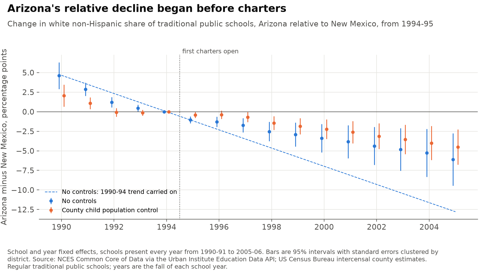
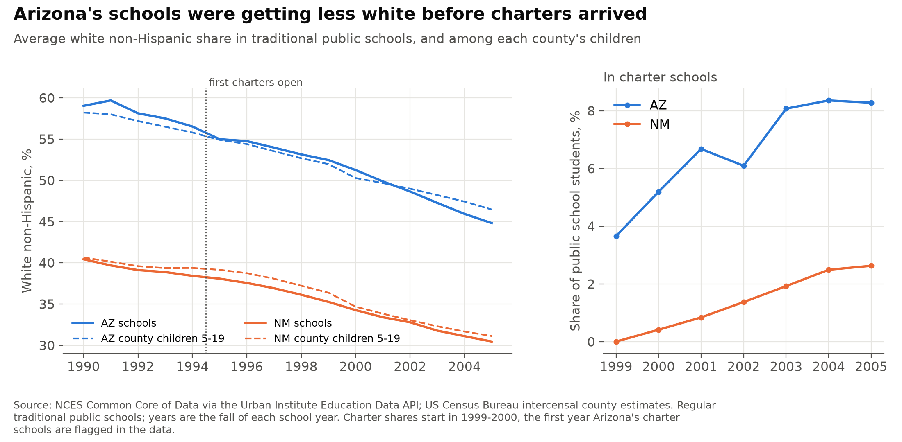
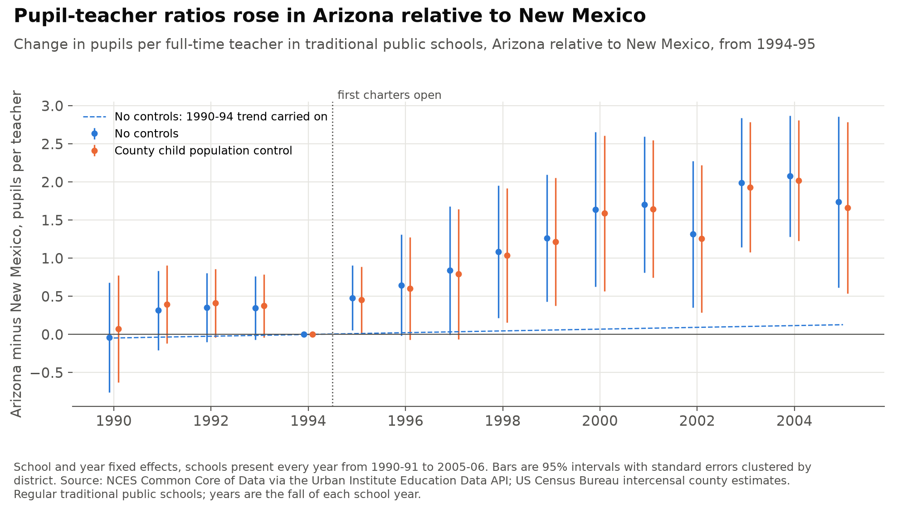

# Did Arizona's charter schools draw white students out of traditional public schools?

After its 1994 law, Arizona had more charter schools than any other state: about 15% of all those operating in the US by 1999. A well-known study, Dee and Fu (2004), compared traditional public schools in Arizona and New Mexico in 1994-95 and 1999-2000. It found that the white non-Hispanic share of students fell 2.6 percentage points more in Arizona, and that pupil-teacher ratios rose by about 1.3 pupils.

This project repeats that two-year comparison and then adds every year from 1990-91 to 2005-06.

**Short answer:**
- **The two-year result reproduces:** a 2.7-point relative fall.
- **The white share was already falling before charters:** Arizona's share was falling relative to New Mexico's at about 1.2 points a year before the first charter school opened. After 1994 it kept falling at about half that pace. Once that earlier trend, or the changing make-up of each county's children, is taken into account, the annual data show no sign that charters drew white students away.
- **Pupil-teacher ratios rose:** the rise relative to New Mexico is clearer, at 1.4 to 1.8 pupils per teacher by 1999 to 2005. Much of it comes from New Mexico's ratio falling, and the estimate is imprecise once a trend is allowed.

> **Personal project.** This is my own analysis of publicly available data. It is not associated with my work for any current or past employer and does not represent their views.

## How it is measured

- **Schools:** every regular traditional public school in Arizona and New Mexico, from the NCES Common Core of Data, read through the Urban Institute's Education Data API. Each school has enrolment, white non-Hispanic students, teachers (full-time equivalents) and district, every year from 1990-91 to 2005-06.
- **Charter schools excluded:** charter schools are flagged in the data only from 1998-99, so a school is dropped if it is ever flagged. So is every school in a district where most flagged schools are charters, since Arizona's charters are their own districts.
- **Pupil-teacher ratios:** trimmed as Dee and Fu did. Ratios above 150% of the 99th percentile or below half the 1st percentile in each year are treated as errors.
- **County control:** the share of each county's 5- to 19-year-olds who are white non-Hispanic, from the US Census Bureau's intercensal county estimates. It separates schools changing because their neighbourhoods changed from schools losing students to charters.
- **Two-year comparison:** the within-school change from 1994-95 to 1999-2000, Arizona against New Mexico, as in Dee and Fu.
- **Annual comparison:** an event study. Each school's outcome is regressed on school and year fixed effects and an Arizona dummy for every year except 1994-95. The main estimates use the 1,387 schools present in all 16 years. Standard errors are clustered by school district.
- **Trend check:** a version that also gives Arizona its own linear trend, estimated from 1990-91 to 1994-95, and measures later years as departures from that trend carried forward.

## 1. The two-year comparison reproduces the published estimate

| Outcome | Specification | Estimate | SE (robust) | SE (district clusters) | Dee and Fu |
|---|---|---:|---:|---:|---:|
| White non-Hispanic share | No controls | −0.027 | 0.004 | 0.007 | −0.026 (0.004) |
| White non-Hispanic share | County child population | −0.018 | 0.004 | 0.005 | −0.009 (0.004) |
| White non-Hispanic share | County, locale × year, level × year | −0.011 | 0.003 | 0.005 | |
| Pupil-teacher ratio | No controls | 1.41 | 0.18 | 0.38 | 1.26 (0.16) |
| Pupil-teacher ratio | County, locale × year, level × year | 1.37 | 0.19 | 0.45 | |

1,679 schools, 1,016 of them in Arizona. Without controls the estimates are close to the published ones. As in the original study, the white share estimate shrinks when the county's child population is controlled for. Clustering by district roughly doubles the standard errors. The original reports heteroscedasticity-robust errors, which do not allow for schools in the same district moving together.

## 2. Arizona's relative decline started before charters



- **Before the law:** in 1990-91 Arizona's white share was 4.6 points higher, relative to New Mexico, than in 1994-95, and it fell steadily to 1994. The four years before the law are jointly far from zero (F = 14.3, p < 0.001).
- **After the law:** the relative decline went on at a slower pace: −2.9 points by 1999-2000 and −6.1 by 2005-06.
- **Against the earlier trend:** with that trend carried forward, Arizona's 1999-2005 average sits 5.4 points above it (SE 1.4). Taken literally, that is the opposite of skimming. It mostly shows that carrying a five-year trend forward for eleven years is a strong assumption.
- **With the county control:** most of the earlier trend goes away, because Arizona's child population was itself becoming less white faster. The remaining post-1994 decline averages −3.1 points over 1999-2005 (SE 0.8). Against Arizona's own pre-1995 trend it is +1.6 points (SE 1.5), indistinguishable from zero.



In both states, school shares follow the county child population closely. Charter schools enrolled 3.7% of Arizona's public school students in 1999-2000 and 8.3% by 2005-06.

## 3. Pupil-teacher ratios rose in Arizona relative to New Mexico



- **Before 1994:** the earlier years are close to flat, though not exactly: F = 2.5, p = 0.04 in the balanced panel, and p = 0.44 with all schools.
- **After 1994:** the ratio rose year by year after charters opened, averaging 1.7 pupils per teacher over 1999-2005 (SE 0.4).
- **With a trend:** allowing Arizona its own pre-1995 trend leaves the estimate at 1.4 but widens the standard error to 1.0.
- **Where the gap comes from:** Arizona's ratio fell from 19.3 to 18.3 between 1994-95 and 2005-06 in these schools. New Mexico's fell from 17.8 to 14.5. Much of the gap is New Mexico hiring more teachers per pupil, which these data cannot attribute to Arizona's charters.

## Limits

- **One treated state and one control.** Anything else that changed in Arizona or New Mexico after 1994 is absorbed into the estimates. Like Dee and Fu, this leaves out Nevada and Utah: Nevada's population was changing in a distinct way, and Utah was funding a large reduction in class sizes over the period.
- **Charter flags arrive late.** A charter school that opened and closed before 1998-99, outside a charter district, would stay in the sample. The balanced panel limits this, since such schools are not present in every year.
- **The county control is coarse.** County child populations are not school catchments, and the 1990s and 2000s estimates come from two Census Bureau series.
- **Linear trends are a choice.** The trend-adjusted estimates depend on carrying a 1990-1994 line forward. They are shown as a check on the plain event study, not as a better estimate.
- **Data vintage.** The CCD files used here are later releases than the ones Dee and Fu used, so school counts differ slightly.

## Checks

The tests in `tests/` check:
- **Estimator:** the fixed-effects estimator gives the same coefficient and clustered standard error as least squares with a dummy for every school and year (statsmodels).
- **Simulated effect:** on a simulated panel, the event study recovers a known effect and finds no pre-trend.
- **Simulated trend:** on a simulated panel with a pre-trend and no effect, the own-trend version recovers the slope and finds no effect, while the plain version finds a false one.
- **Two-year equivalence:** the two-year first difference equals the fixed-effects estimate on the same two years.
- **Against the published numbers:** the two-year estimates are within 0.5 points (white share) and 0.3 pupils (pupil-teacher ratio) of Dee and Fu's.
- **Data:** the panel has one row per school and year, and the shares lie between 0 and 1.

## Run it

```bash
python -m venv .venv
.venv/Scripts/pip install -r requirements-dev.txt   # .venv/bin/pip on macOS and Linux
.venv/Scripts/python data.py       # downloads about 70 MB into data/raw and rebuilds data/panel.csv.gz
.venv/Scripts/python estimate.py   # writes output/*.csv
.venv/Scripts/python figures.py    # writes figures/*.png
.venv/Scripts/python -m pytest
```

The processed panel and county file are committed, so `estimate.py`, `figures.py` and the tests run without downloading.

## References

- Dee, T. S. and H. Fu (2004). Do charter schools skim students or drain resources? *Economics of Education Review* 23(3), 259-271.
- National Center for Education Statistics, Common Core of Data, via the [Urban Institute Education Data Portal](https://educationdata.urban.org/).
- US Census Bureau, intercensal county estimates by age, sex, race and Hispanic origin, [1990-2000](https://www2.census.gov/programs-surveys/popest/tables/1990-2000/intercensal/st-co/) and [2000-2010](https://www2.census.gov/programs-surveys/popest/datasets/2000-2010/intercensal/county/).
