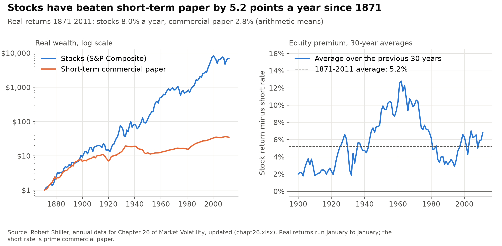
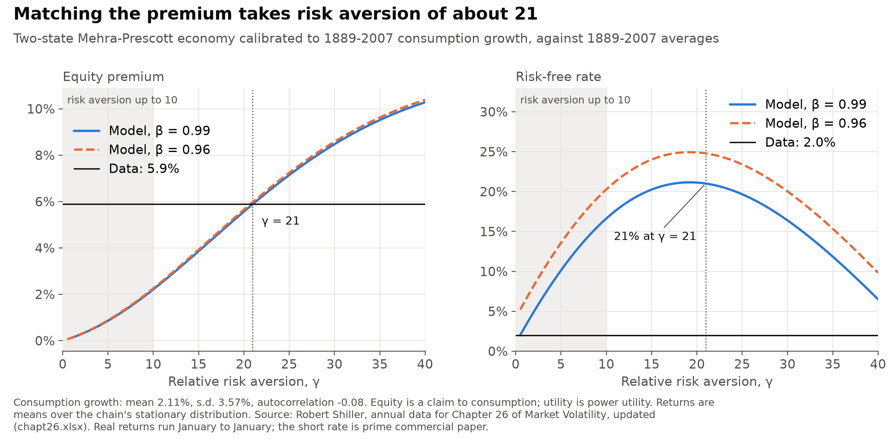
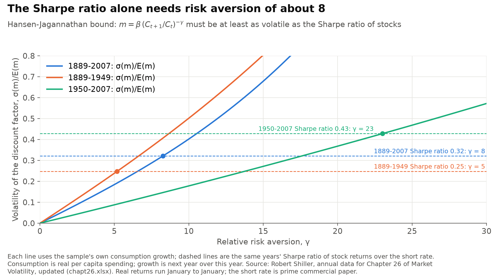
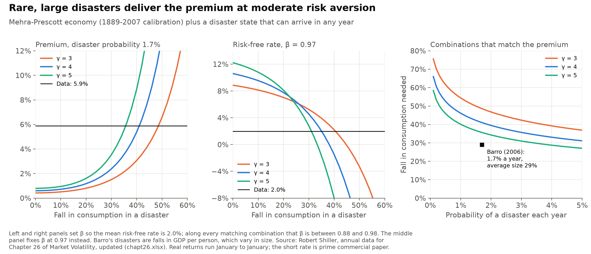

# How large has the US equity premium been, and what would a consumption-based model need to explain it?

Mehra and Prescott (1985) set up a simple economy in which a representative household with power utility prices stocks as a claim to aggregate consumption. With risk aversion of 10 or less and a plausible risk-free rate, the largest equity premium it could produce was 0.35%, against about 6% in US data for 1889-1978.

This project measures the premium in Robert Shiller's annual data from 1871, solves the same economy again with updated consumption data, checks the Hansen and Jagannathan (1991) bound, and adds rare disasters as in Rietz (1988) and Barro (2006).

**Short answer:**
- **The premium:** from 1871 to 2011, stocks returned 8.0% a year after inflation and short-term commercial paper 2.8%, a premium of 5.2 points. It was 4.3 points before 1950 and 6.4 points after.
- **The standard model needs risk aversion of about 21:** calibrated to 1889-2007 consumption growth, Mehra and Prescott's economy matches that period's 5.9-point premium only at a relative risk aversion of about 21. At that level its risk-free rate is 21%, against 2.0% in the data. Bringing the rate down would take a discount factor of 1.17, meaning people would value next year's consumption more than this year's.
- **The Sharpe ratio alone needs about 8:** the Hansen-Jagannathan bound, which uses only how volatile consumption is, needs risk aversion of at least 8.3 over 1889-2007. Since 1950 consumption has been much smoother and the bound needs 23.
- **Rare disasters can do it at risk aversion of 3 to 5:** with a 1.7% chance each year of a disaster, consumption has to fall by 36% to 49% in one to produce the premium. The discount factor that then matches the 2.0% risk-free rate is 0.93, so both the premium and the risk-free rate are matched. Barro's average fall of 29% gives a premium of 1.4 to 3.2 points.

> **Personal project.** This is my own analysis of publicly available data. It is not associated with my work for any current or past employer and does not represent their views.

## How it is measured

- **Data:** Robert Shiller's annual workbook for Chapter 26 of *Market Volatility*, updated. Stocks are the S&P Composite index in January plus dividends paid over the year. The short rate is the 6-month prime commercial paper rate, with January and July rates compounded to a year (6-month certificates of deposit after 1997). Prices are deflated by the January CPI. Consumption is real personal consumption spending per person: Kendrick's NBER series to 1929 and the national accounts after.
- **Returns:** real, simple, January to January. The premium is the stock return minus the short rate. Means are arithmetic, as in Mehra and Prescott. The Sharpe ratio is the mean premium over its standard deviation.
- **Consumption timing:** growth for year t is consumption in year t+1 over consumption in year t, so it lines up with the return from January of t to January of t+1 (the "beginning-of-period" convention in Campbell, 2003). This matters for correlations, not for means or standard deviations.
- **Samples:** the workbook's short rate ends in 2011 and its consumption in 2009. The 2009 value covers only the second quarter, so it is dropped and consumption growth runs from 1889 to 2007. Model calibrations use years with both returns and consumption.
- **Mehra-Prescott economy:** consumption growth follows a two-state Markov chain whose mean, standard deviation and first-order autocorrelation match the data. Equity pays aggregate consumption as its dividend. The discount factor β is either fixed (0.96 or 0.99) or set at each level of risk aversion γ so the model's average risk-free rate equals the data's.
- **Hansen-Jagannathan bound:** for each γ, the volatility of the discount factor m = β(C<sub>t+1</sub>/C<sub>t</sub>)<sup>−γ</sup> relative to its mean, from the sample's own consumption growth. β cancels. The bound needs this to be at least the Sharpe ratio.
- **Disasters:** a third state in which consumption falls by a fixed share. It can happen with the same probability every year, whatever the current state. After it, the economy goes back to the two normal states. β is set so the average risk-free rate is 2.0% (1889-2007), and a combination counts as matching if the premium equals 5.9 points with β below one.

## 1. Stocks have beaten short-term paper by about 5 points a year



| Returns | Stocks | Short rate | Premium | S.d. of premium | Sharpe ratio | Consumption years | Growth mean | Growth s.d. | Autocorrelation | Correlation with stocks |
|---|---:|---:|---:|---:|---:|---|---:|---:|---:|---:|
| 1871-2011 | 8.0% | 2.8% | 5.2 | 18.2 | 0.29 | 1889-2007 | 2.1% | 3.6% | −0.08 | 0.55 |
| 1889-2007 | 7.9% | 2.0% | 5.9 | 18.3 | 0.32 | 1889-2007 | 2.1% | 3.6% | −0.08 | 0.55 |
| 1889-1978 | 7.4% | 1.7% | 5.7 | 19.5 | 0.29 | 1889-1978 | 2.1% | 4.0% | −0.11 | 0.57 |
| 1871-1949 | 7.9% | 3.6% | 4.3 | 19.5 | 0.22 | 1889-1949 | 2.0% | 4.7% | −0.12 | 0.61 |
| 1950-2011 | 8.1% | 1.7% | 6.4 | 16.5 | 0.39 | 1950-2007 | 2.2% | 1.8% | 0.24 | 0.49 |

Real returns and consumption growth per year. The premium and its standard deviation are in percentage points.

- **Growth of a dollar:** $1 put in stocks in January 1871 was worth $6,967 in real terms by January 2012. In commercial paper it was worth $34.70. Compounded (geometric) returns were 6.5% for stocks and 2.5% for paper.
- **Over 30-year windows:** the average premium ranged from 1.8 points (1874-1903) to 12.8 points (1933-1962).
- **Before and after 1950:** stock returns were about the same in both periods (7.9% and 8.1%). The premium rose because the short rate fell, from 3.6% to 1.7%. Consumption growth became much smoother, with a standard deviation of 4.7% before 1950 and 1.8% after.
- **Timing of consumption:** with growth measured as next year over this year, its correlation with stock returns is 0.55 over the full sample. Measured as this year over last year, it is −0.01. Stock prices move before consumption.

**Against Mehra and Prescott's 1889-1978 numbers:**

| | Mehra and Prescott | Here | Gap |
|---|---:|---:|---:|
| Stock return | 6.98% | 7.41% | +0.43 |
| Short rate | 0.80% | 1.73% | +0.93 |
| Premium | 6.18 | 5.68 | −0.50 |
| Consumption growth, mean | 1.83% | 2.12% | +0.29 |
| Consumption growth, s.d. | 3.57% | 4.01% | +0.44 |
| Consumption growth, autocorrelation | −0.14 | −0.11 | +0.03 |

The stock return is close. The short rate is about one point higher because Shiller's series is commercial paper throughout, where Mehra and Prescott used Treasury securities for much of their sample. Consumption has been revised since 1985 and is more volatile in the current data.

## 2. In Mehra and Prescott's economy, matching the premium takes risk aversion near 20



| Calibration | Growth mean | Growth s.d. | Autocorrelation | γ to match premium (β = 0.99) | Risk-free rate at that γ | β to match risk-free rate | γ with β set to match the rate | Largest premium, γ ≤ 10 and rate ≤ 4% |
|---|---:|---:|---:|---:|---:|---:|---:|---:|
| Mehra and Prescott's inputs | 1.83% | 3.57% | −0.14 | 17.8 | 15.5% | 1.13 | 18.5 | 0.35% |
| 1889-1978 | 2.12% | 4.01% | −0.11 | 15.7 | 16.4% | 1.13 | 16.4 | 0.37% |
| 1889-2007 | 2.11% | 3.57% | −0.08 | 21.0 | 21.0% | 1.17 | 22.4 | 0.28% |

The first row uses the growth moments Mehra and Prescott published; the columns after them are computed here. Each calibration is matched to its own premium and risk-free rate: 6.18 and 0.80% (published), 5.68 and 1.73% (1889-1978), 5.88 and 1.99% (1889-2007).

- **Mehra and Prescott's own result reproduces:** with their numbers, the largest premium for γ up to 10, β below one and a risk-free rate of at most 4% is 0.35%.
- **At γ = 10:** with the 1889-2007 calibration and β = 0.99, the premium is 2.2 points and the risk-free rate 16.6%.
- **Matching the premium:** it takes γ = 21. The risk-free rate is then 21%, and a β of 1.17 would be needed to bring it to 2.0%. Setting β to match the risk-free rate at every γ changes little: γ = 22.
- **The premium hardly depends on β:** the lines for β = 0.96 and 0.99 lie almost on top of each other. β mainly moves the risk-free rate.
- **Past γ of about 20 the risk-free rate falls again:** the wish to save against the low-growth state starts to outweigh the wish to borrow against expected growth.
- **Model stocks are too smooth:** at γ = 21 the model's stock returns have a standard deviation of 11.7%, against 18.1% in 1889-2007.

## 3. The Hansen-Jagannathan bound asks for less, but still a lot



| Years | Sharpe ratio | γ to clear the bound | β at that γ for the mean short rate | Lognormal approximation | From the covariance with consumption |
|---|---:|---:|---:|---:|---:|
| 1889-2007 | 0.32 | 8.3 | 1.11 | 9.1 | 15.9 |
| 1889-1978 | 0.29 | 6.9 | 1.09 | 7.4 | 12.3 |
| 1889-1949 | 0.25 | 5.2 | 1.05 | 5.4 | 8.4 |
| 1950-2007 | 0.43 | 23.0 | 1.50 | 24.7 | 55.9 |

- **What the bound asks for:** any discount factor that prices stocks and the short rate must have σ(m)/E(m) at least as large as the Sharpe ratio. With power utility, that needs γ of at least 8.3 over 1889-2007. The lognormal shortcut, the Sharpe ratio divided by the standard deviation of log consumption growth, gives 9.1.
- **It is a lower bound:** the bound allows the discount factor to be perfectly correlated with stock returns. Consumption growth is correlated 0.57 with the excess return here, so the first-order condition, premium = γ × cov(consumption growth, excess return), needs γ of 15.9. That is close to the 21 the Markov economy needs.
- **The risk-free rate again:** at γ = 8.3, matching the mean short rate needs β of 1.11.
- **Since 1950:** consumption growth has a standard deviation of 1.8% and the Sharpe ratio is 0.43, so the bound alone needs γ = 23.

## 4. Rare disasters deliver the premium at moderate risk aversion



Disaster probability 1.7% a year, Barro's estimate:

| γ | Premium, no disasters | β for 2.0% rate, no disasters | Premium, 29% fall | Fall needed for 5.9 points | β for 2.0% rate at that fall | Risk-free rate at β = 0.97: none / 29% / needed | Stock s.d. at that fall |
|---:|---:|---:|---:|---:|---:|---|---:|
| 3 | 0.43 | 1.04 | 1.41 | 48.6% | 0.93 | 9.0% / 5.5% / −2.3% | 8.2% |
| 4 | 0.61 | 1.05 | 2.21 | 41.0% | 0.93 | 10.7% / 5.0% / −2.4% | 7.6% |
| 5 | 0.81 | 1.07 | 3.24 | 35.6% | 0.93 | 12.4% / 3.5% / −2.3% | 7.2% |

- **Without disasters:** γ of 3 to 5 gives a premium below 1 point, and matching the 2.0% risk-free rate needs β above one.
- **Disasters work on both puzzles:** they raise the premium, because stocks fall in the states where people value income most, and they lower the risk-free rate, because people save against them. At γ = 4 and β = 0.97, the risk-free rate falls from 10.7% with no disasters to 5.0% with 29% falls and to −2.4% with the 41% falls that match the premium. So the β that matches the 2.0% rate drops from 1.05 to 0.93.
- **Which combinations match:** at γ = 4, a 1% annual probability needs a 46% fall, 3% needs 36%, and 5% needs 31%. Along every matching combination for γ of 3 to 5, β is between 0.88 and 0.98.
- **Against Barro's evidence:** a fixed 29% fall, his average, gives 1.4 to 3.2 points. Barro uses the whole range of falls, from 15% to 64%, and because marginal utility rises steeply in bad states the larger falls count for more than the average suggests. These are falls in GDP per person, mostly outside the US. The largest one-year fall in this US consumption series is 9.5%, from 1931 to 1932.
- **Stocks are still too smooth:** at a 1.7% probability, the matching combinations give model stock returns a standard deviation of 7.2% to 8.2%, against 18.1% in the data. Disasters fix the average premium, not volatility.

## Limits

- **The short rate is not risk-free.** Commercial paper carries some default risk and pays more than Treasury bills, so the premium here is smaller than it would be against bills.
- **Annual averages of consumption.** Consumption is an average over each year, which smooths growth and blurs its timing against January-to-January returns. The correlation with returns depends heavily on the timing choice.
- **Equity is a claim to consumption.** Real stocks are leveraged claims on dividends, which are far more volatile than consumption. This is one reason the model's stock returns are too smooth.
- **One disaster size, no default.** The disaster state has a single size, lasts one year, and does not affect the short rate. Barro uses a distribution of sizes and allows partial default on bills during disasters.
- **Power utility only.** Risk aversion and the willingness to substitute over time are tied together. Recursive utility, habits and long-run risk are other ways to approach the same numbers and are not covered.
- **Data vintage.** The workbook's short rate ends in 2011 and consumption in 2009, so the post-2011 years are not included.

## Checks

The tests in `tests/` check:
- **Closed forms:** with i.i.d. growth, the Markov pricer gives the closed-form equity and risk-free returns, for a symmetric two-state chain and for lognormal growth on Gauss-Hermite nodes (where the premium in logs is γσ²).
- **Mehra and Prescott's result:** with their parameters, the largest premium in their admissible region is 0.35%.
- **Disaster chain:** probabilities sum to one, the disaster state's long-run frequency equals its probability, the β rule hits the target risk-free rate, and a zero-probability disaster changes nothing.
- **Against the published numbers:** the 1889-1978 means are within 1 point of Mehra and Prescott's for returns and 0.5 points for consumption growth.
- **Data:** one row per year from 1871, positive prices and consumption, the expected numbers of years, and returns rebuilt from prices, dividends, rates and the CPI equal to Shiller's own return columns.

## Run it

```bash
python -m venv .venv
.venv/Scripts/pip install -r requirements-dev.txt   # .venv/bin/pip on macOS and Linux
.venv/Scripts/python data.py       # downloads chapt26.xlsx (about 100 KB) into data/raw and rebuilds data/shiller_annual.csv
.venv/Scripts/python estimate.py   # writes output/*.csv
.venv/Scripts/python figures.py    # writes figures/*.png
.venv/Scripts/python -m pytest
```

The processed series is committed, so `estimate.py`, `figures.py` and the tests run without downloading.

## References

- Barro, R. J. (2006). Rare disasters and asset markets in the twentieth century. *Quarterly Journal of Economics* 121(3), 823-866.
- Campbell, J. Y. (2003). Consumption-based asset pricing. In G. Constantinides, M. Harris and R. Stulz (eds.), *Handbook of the Economics of Finance*, vol. 1B, 803-887.
- Hansen, L. P. and R. Jagannathan (1991). Implications of security market data for models of dynamic economies. *Journal of Political Economy* 99(2), 225-262.
- Mehra, R. and E. C. Prescott (1985). The equity premium: A puzzle. *Journal of Monetary Economics* 15(2), 145-161.
- Rietz, T. A. (1988). The equity risk premium: A solution. *Journal of Monetary Economics* 22(1), 117-131.
- Shiller, R. J. (1989). *Market Volatility*. MIT Press. Data: [chapt26.xlsx](http://www.econ.yale.edu/~shiller/data/chapt26.xlsx), updated by the author.
