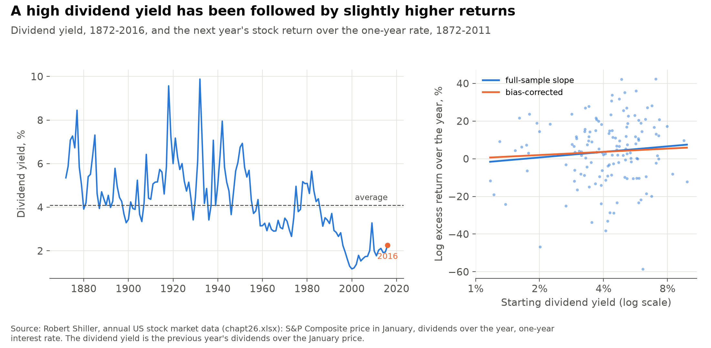
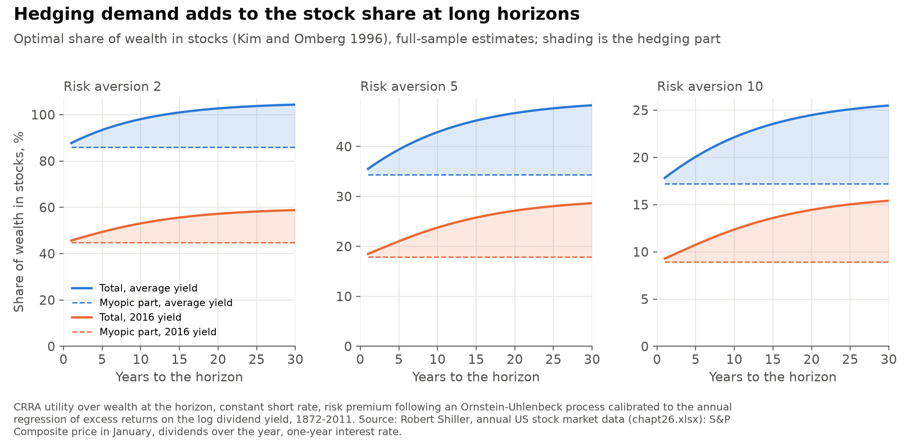
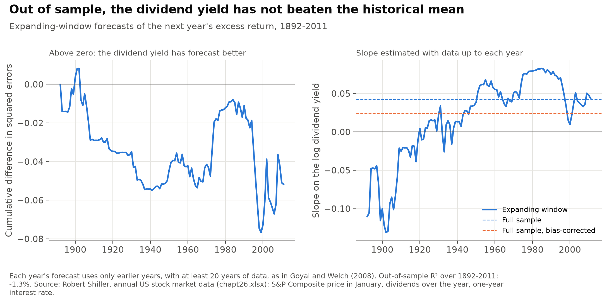
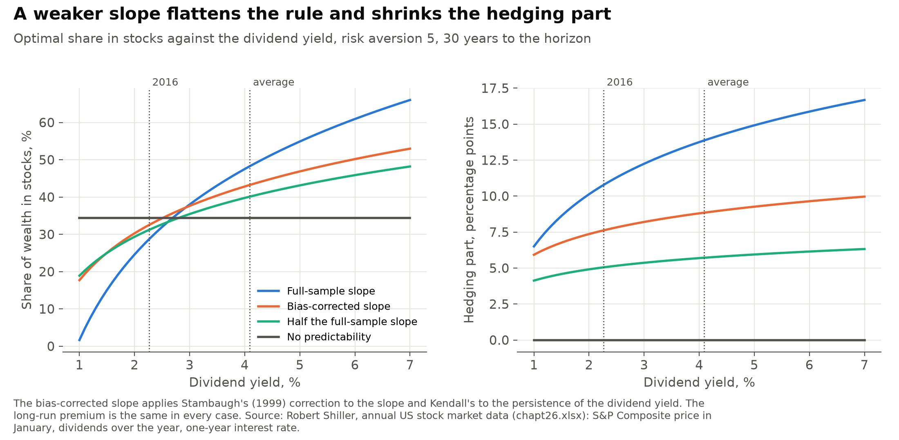

# Should a long-term investor hold more stocks when the dividend yield is high?

If a high dividend yield signals higher future returns, a long-term investor has two reasons to hold stocks. The first is the expected return over the next instant, which gives the usual one-period, or myopic, share. The second is hedging: a fall in prices raises the yield and so the returns that follow, which makes stocks less risky over long horizons than over short ones. Kim and Omberg (1996) solve this problem in closed form. This project fits their model to Robert Shiller's annual US data from 1872 to 2011 and asks how large each part is.

**Short answer:**
- **In the model, yes.** With the full-sample estimates, an investor with risk aversion 5 and 30 years to go would hold 48% of wealth in stocks at the average dividend yield (4.1%) and 29% at the January 2016 yield (2.3%).
- **The hedging part is smaller than the myopic part.** It grows with the horizon, but at 30 years it is 21% to 48% of the myopic part at the average yield, for risk aversion from 2 to 10. At one year it is 2% to 4%.
- **The evidence behind it is weak.** The slope of next year's excess return on the log dividend yield is 0.043 with a t-statistic of 1.2. Corrected for Stambaugh bias it is 0.025. Out of sample, the forecast has not beaten the historical mean (R² of −1.3% for 1892-2011).
- **The hedging part shrinks faster than the slope.** With half the slope, the 30-year hedging part for risk aversion 5 falls from 13.9 to 5.7 percentage points.

> **Personal project.** This is my own analysis of publicly available data. It is not associated with my work for any current or past employer and does not represent their views.

## How it is measured

- **Data:** Shiller's annual file (`chapt26.xlsx`): the S&P Composite price in January, dividends over each calendar year, and a one-year interest rate. I use it rather than the monthly file (`ie_data.xls`) because it has a short rate, so excess returns are measured against a rate from the same source. The monthly file has only the 10-year Treasury yield. Annual returns also match the annual model calibration and do not overlap. The cost is that the annual file ends in 2016: the interest rate ends in 2011 and the last dividend yield is for January 2016. "Current" below means January 2016.
- **Variables:** the dividend yield at the start of year t is the previous year's dividends over the January price. The excess return is the log total return on the index over the year minus the log return on the one-year rate.
- **Predictive regression:** next year's excess return on the log dividend yield, and the log dividend yield as an AR(1), by least squares over the 140 years from 1872 to 2011.
- **Stambaugh bias:** the dividend yield is persistent and its shocks are strongly negatively correlated with return shocks. Its estimated persistence is biased down in a finite sample, and that biases the slope up (Stambaugh 1999). The corrected slope subtracts the implied bias, using Kendall's (1954) approximation for the bias in the AR(1) coefficient.
- **Model:** a stock and a riskless asset with a constant short rate. The stock's risk premium follows an Ornstein-Uhlenbeck process, and its shocks are correlated with the stock's. The investor has CRRA utility over wealth at the horizon. The optimal stock share is x/(γσ²), the myopic part, plus an intertemporal hedging part that depends on the horizon.
- **From regression to model:** the premium is the expected log excess return plus half the return variance. Its mean reversion is −ln of the AR(1) coefficient. Its volatility is set so that its annual shock has the variance of the slope times the dividend-yield shock, and the shock correlation is that of the regression residuals. This first-order mapping ignores movement in the premium within a year.
- **Closed form and numerical solution:** the value function is exponential-quadratic in the premium, so the problem reduces to a Riccati equation and a linear equation in the horizon. `model.py` gives Kim and Omberg's closed form and also integrates the equations with `scipy.integrate.solve_ivp`. For risk aversion of 1 or more the closed form is always in Kim and Omberg's "normal" case and stays finite, so no numerical fallback was needed. For risk aversion below 1 it can explode at long horizons; that case is not used here.
- **Out of sample:** as in Goyal and Welch (2008), each year's excess return is forecast from a regression on all earlier years, with at least 20 years of data. The benchmark is the mean of the same earlier years. The out-of-sample R² is one minus the ratio of the two sums of squared errors.

## 1. The dividend yield predicts returns only weakly



| | Estimate | SE |
|---|---:|---:|
| Slope on the log dividend yield | 0.043 | 0.035 |
| R² | 1.1% | |
| AR(1) coefficient of the log dividend yield | 0.886 | 0.041 |
| Correlation of return and dividend-yield shocks | −0.80 | |
| Slope, bias-corrected | 0.025 | |
| AR(1) coefficient, bias-corrected | 0.913 | |

- **In sample:** a dividend yield one log point higher has been followed by excess returns 4.3 percentage points higher, but the t-statistic is 1.2.
- **The bias correction lowers the slope** from 0.043 to 0.025. The dividend yield becomes more persistent, with the half-life of the premium rising from 5.8 to 7.6 years.
- **In the model:** the long-run premium is 5.3% a year and return volatility is 17.5%. The premium's own volatility is 0.9 percentage points a year. At the January 2016 yield of 2.3%, the full-sample premium is 2.7%.

## 2. The hedging part adds to the stock share, but less than the myopic part



Share of wealth in stocks, %, with the full-sample estimates:

| Risk aversion | Starting yield | Myopic | Hedging, 1 year | Hedging, 10 years | Hedging, 30 years | Total, 30 years |
|---:|---|---:|---:|---:|---:|---:|
| 2 | 4.1% (average) | 86.0 | 1.7 | 12.1 | 18.4 | 104.3 |
| 2 | 2.3% (2016) | 44.7 | 1.0 | 8.4 | 14.1 | 58.8 |
| 5 | 4.1% (average) | 34.4 | 1.1 | 8.5 | 13.9 | 48.3 |
| 5 | 2.3% (2016) | 17.9 | 0.6 | 5.9 | 10.8 | 28.7 |
| 10 | 4.1% (average) | 17.2 | 0.6 | 4.9 | 8.3 | 25.5 |
| 10 | 2.3% (2016) | 8.9 | 0.3 | 3.4 | 6.5 | 15.4 |

- **Sign:** the hedging part is positive. Return shocks and premium shocks are negatively correlated: stocks do well when expected returns fall and badly when they rise. For an investor more risk-averse than log utility, that makes stocks a hedge against falling future returns.
- **Horizon:** the hedging part is close to zero at one year and rises steadily with the horizon, levelling off as it approaches 30 years.
- **Size:** at 30 years and the average yield, the hedging part is 0.21, 0.40 and 0.48 times the myopic part for risk aversion 2, 5 and 10. The myopic part falls in proportion to risk aversion; the hedging part falls more slowly.
- **Dividend yield:** both parts are larger when the yield is high. At the 2016 yield the myopic part is about half its value at the average yield. The hedging part falls by less, so it is a larger fraction of the total: 0.60 times the myopic part for risk aversion 5 at 30 years.

## 3. Out of sample, the dividend yield has not beaten the historical mean



| Forecasts | Number | Out-of-sample R² |
|---|---:|---:|
| 1892-2011 | 120 | −1.3% |
| 1927-2011 | 85 | −0.5% |
| 1965-2011 | 47 | 0.0% |

- **The record:** the dividend-yield forecast did better than the historical mean from the 1970s to the mid-1980s, then lost most of that in the late 1990s, when low yields pointed to low returns that did not come. Its cumulative shortfall was largest in 1999.
- **The slope is unstable:** estimated with data up to each year, it was negative in most years up to the early 1920s, reached 0.083 in 1985 and fell to 0.010 in 2000.
- **For the portfolio rule:** the model takes the estimated slope as known. A forecast that cannot beat the mean in real time does not support a rule that moves the stock share sharply with the dividend yield.

## 4. With a weaker slope, the rule flattens and the hedging part shrinks



Hedging part at 30 years and the average yield, percentage points:

| Slope | Value | Risk aversion 2 | Risk aversion 5 | Risk aversion 10 |
|---|---:|---:|---:|---:|
| Full sample | 0.043 | 18.4 | 13.9 | 8.3 |
| Bias-corrected | 0.025 | 12.4 | 8.8 | 5.2 |
| Half the full-sample slope | 0.021 | 8.3 | 5.7 | 3.3 |

- **The hedging part falls by more than half when the slope is halved.** Its scale is the premium's volatility, which halves with the slope, and the horizon terms B and C that multiply it are also smaller when the premium is less volatile.
- **The bias-corrected slope is only a little larger than half the full-sample slope**, but the hedging part is larger, because the corrected dividend yield is also more persistent.
- **The rule flattens.** For risk aversion 5 at 30 years, the share rises from 24.6% at a 2% yield to 60.9% at a 6% yield with the full-sample slope. With half the slope it rises from 29.3% to 45.9%. With no predictability it is 34.4% at every yield and every horizon.
- **The myopic part at the average yield does not change.** The long-run premium is the same in every case, so what changes is how much the share moves with the yield and how much is added for the horizon.

## Limits

- **Not investment advice.** This is a model applied to historical data. The slope it depends on is not statistically different from zero, and it has not forecast returns better than the historical average out of sample. None of the shares above should be read as a recommendation for anyone's portfolio.
- **Old data.** The annual file ends in 2016, and excess returns end in 2011. Dividend yields since then have stayed low, and more cash now reaches shareholders through buybacks, which the dividend yield does not count.
- **Estimates are treated as known.** The investor in the model knows the slope, persistence and volatilities. Barberis (2000) shows that allowing for uncertainty about them can reduce the horizon effect substantially.
- **A narrow model.** One stock index, a constant short rate, no consumption or income before the horizon, no transaction costs and no limit on borrowing. Shares above 100%, as for risk aversion 2 at long horizons, require borrowing at the short rate. Shocks are normal, so the premium can turn negative at low yields.
- **First-order calibration.** The mapping from the annual regression to the continuous-time model ignores how the premium moves within a year. That is a small effect next to the sampling uncertainty in the slope.
- **The bias correction is approximate.** It removes the average bias under the model's assumptions; it does not reduce the uncertainty around the slope.

## Checks

The tests in `tests/` check:
- **Closed form against the ODEs:** B(τ) and C(τ) from Kim and Omberg's formulas match the `solve_ivp` solution at horizons from 1 to 50 years, for risk aversion from 1.5 to 50 and two parameter sets, and so do the hedging shares. The `hedging_ode` column in `output/allocation.csv` repeats this for every reported share.
- **Against the HJB equation:** the value function built from the ODE solution satisfies the HJB equation when its derivatives are taken by finite differences, and maximising the HJB numerically over the stock share gives the model's share.
- **No predictability:** with a zero slope the premium is constant, and the share equals Merton's (μ − r)/(γσ²) at every horizon. The same holds when premium shocks are uncorrelated with returns.
- **Log utility:** with risk aversion 1 the hedging part is zero at every horizon.
- **Bias correction:** in simulated samples of 140 years with no true predictability and the sample's persistence and correlation, the least-squares slope is biased up and the corrected slope is close to zero on average.
- **No look-ahead:** changing the last return leaves every earlier out-of-sample forecast unchanged.
- **Data:** one row per year from 1871 to 2016, dividend yields between 1% and 10%, the excess return from Shiller's real-return columns equal to the one built from nominal prices, dividends and the interest rate, and an estimation sample of 140 consecutive years.

## Run it

```bash
python -m venv .venv
.venv/Scripts/pip install -r requirements-dev.txt   # .venv/bin/pip on macOS and Linux
.venv/Scripts/python data.py       # downloads about 0.1 MB into data/raw and rebuilds data/shiller_annual.csv
.venv/Scripts/python estimate.py   # writes output/*.csv
.venv/Scripts/python figures.py    # writes figures/*.png
.venv/Scripts/python -m pytest
```

The processed annual file is committed, so `estimate.py`, `figures.py` and the tests run without downloading.

## References

- Barberis, N. (2000). Investing for the long run when returns are predictable. *Journal of Finance* 55(1), 225-264.
- Goyal, A. and I. Welch (2008). A comprehensive look at the empirical performance of equity premium prediction. *Review of Financial Studies* 21(4), 1455-1508.
- Kendall, M. G. (1954). Note on bias in the estimation of autocorrelation. *Biometrika* 41(3/4), 403-404.
- Kim, T. S. and E. Omberg (1996). Dynamic nonmyopic portfolio behavior. *Review of Financial Studies* 9(1), 141-161.
- Merton, R. C. (1969). Lifetime portfolio selection under uncertainty: the continuous-time case. *Review of Economics and Statistics* 51(3), 247-257.
- Stambaugh, R. F. (1999). Predictive regressions. *Journal of Financial Economics* 54(3), 375-421.
- Shiller, R. J. US stock market data, annual series from *Market Volatility* (1989), chapter 26, [econ.yale.edu/~shiller/data.htm](http://www.econ.yale.edu/~shiller/data.htm).
