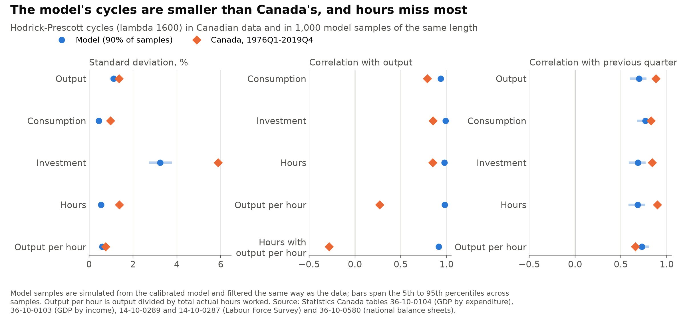
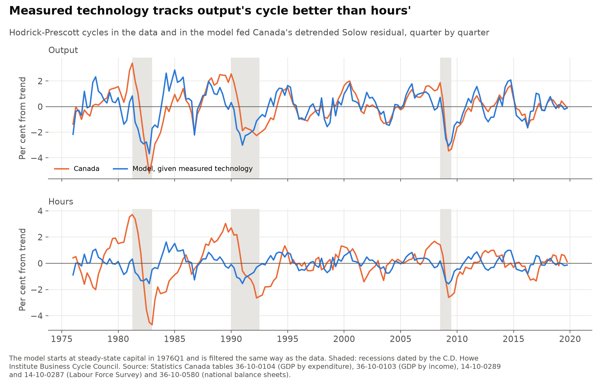
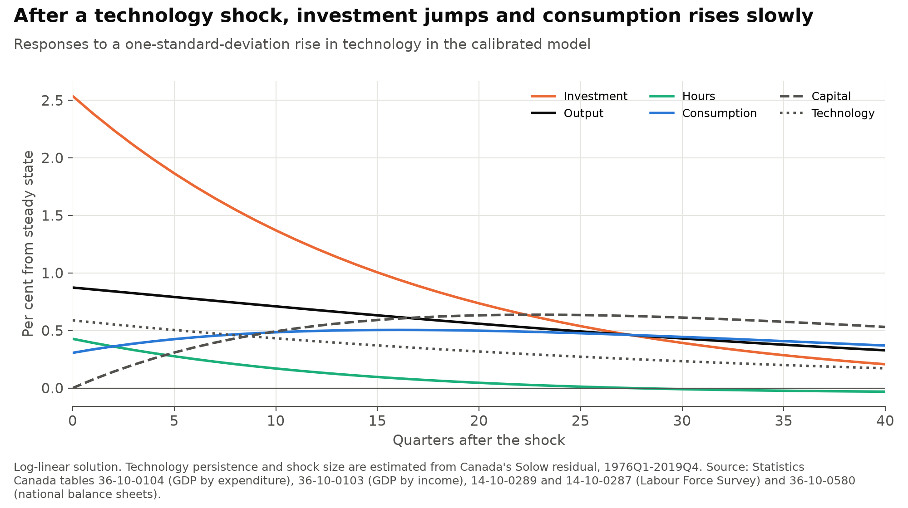

# How much of Canada's business cycle does a basic real business cycle model reproduce?

A real business cycle model treats booms and recessions as the response of households and firms to changes in productivity, with nothing else going wrong. This project calibrates the standard version of that model to Canadian national accounts, feeds it technology shocks estimated from Canada's own data, and compares its cycles with Canada's from 1976 to 2019.

**Short answer:**
- **Most of output's volatility:** the model's output moves around its trend with a standard deviation of 1.12%, against 1.37% in the data, a ratio of 0.82 (0.67 in variance). Fed the measured technology series quarter by quarter, its output cycle has a correlation of 0.69 with Canada's.
- **The broad pattern:** consumption, investment and hours all rise and fall with output, and investment swings more than output and consumption less, as in the data.
- **It misses hours and labour productivity:** hours swing half as much as output in the model (0.49 times) and as much as output in the data (1.00). Output per hour moves almost one for one with output in the model (correlation 0.98) and only loosely in the data (0.27). Hours and output per hour rise together in the model (0.91) and move against each other in the data (−0.28).
- **It also misses persistence:** the model's cycles fade faster. Output's correlation with its previous quarter is 0.70 in the model and 0.88 in the data.

> **Personal project.** This is my own analysis of publicly available data. It is not associated with my work for any current or past employer and does not represent their views.

## How it is measured

- **Data:** quarterly, from Statistics Canada, seasonally adjusted. Output is GDP in chained 2017 dollars. Consumption is household and non-profit consumption other than durable goods. Investment is business and non-profit fixed investment (including housing), plus durable goods and inventories. Hours are total actual hours worked at main jobs in the Labour Force Survey, monthly averaged to quarters. Government purchases and net exports are not part of the model and are left out.
- **Sample:** 1976Q1 to 2019Q4, 176 quarters. Hours start in 1976, and the pandemic quarters are left out of the main comparison.
- **Model:** the basic model of King, Plosser and Rebelo (1988), without trend growth. A household has log utility in consumption and a separate log term in leisure, production is Cobb-Douglas, and technology follows an AR(1) in logs. There is no government, trade, money or friction of any kind.
- **Solution:** the steady state, a log-linear approximation around it, and the Blanchard and Kahn (1980) method, written out in numpy (`model.py`).
- **Calibration:** to 1990-2019 averages, since the balance sheet capital stock starts in 1990.

| Parameter | Value | From |
|---|---:|---|
| Capital share, α | 0.334 | 1 minus the labour share, 0.666: compensation of employees over compensation plus gross operating surplus. Mixed income and net taxes, which combine labour and capital income, are left out of both. |
| Depreciation, δ (quarterly) | 0.029 | Investment (0.254 of GDP) over capital (8.73 quarters of GDP), both at current prices. Capital is the fixed assets, inventories and consumer durables of every sector except government in the national balance sheets, at market value. This is the model's own steady state, which has no trend growth. |
| Discount factor, β | 0.991 | The steady-state Euler equation, 1 / (1 + α Y/K − δ) |
| Share of time worked, h | 0.246 | 24.6 hours actually worked a week per person aged 15 to 64, out of 100 hours of discretionary time, as in Cooley and Prescott (1995) |
| Weight on leisure, θ | 2.73 | Set so that the household works the share h. The implied Frisch elasticity of hours is 3.06. |
| Technology persistence, ρ | 0.970 | Estimated, see below |
| Technology shock, σ | 0.0059 | Estimated, see below |

- **Technology:** hours and capital data are both available, so ρ and σ are estimated rather than borrowed. The Solow residual is log output less α times log capital less (1 − α) times log hours. Quarterly capital is built by perpetual inventory from chained investment, starting in 1961 at the calibrated capital-output ratio. A linear trend (0.43% a year) is removed from the residual over 1976-2019, and an AR(1) is fitted to what is left by least squares.
- **Comparison:** 1,000 samples of 176 quarters are simulated from the model, each after 200 quarters of burn-in. Model and data series are logged and passed through the same Hodrick and Prescott (1997) filter, with λ = 1600. The statistics are the standard deviation, the standard deviation relative to output, the correlation with output and the correlation with the previous quarter. Model values are means across samples, and the figure shows the 5th to 95th percentiles.

## 1. The model produces most of output's volatility, with the right ordering

| Series | Std. dev. %, data | Model | Relative to output, data | Model | Correlation with output, data | Model | Autocorrelation, data | Model |
|---|---:|---:|---:|---:|---:|---:|---:|---:|
| Output | 1.37 | 1.12 | 1.00 | 1.00 | 1.00 | 1.00 | 0.88 | 0.70 |
| Consumption | 0.97 | 0.44 | 0.71 | 0.39 | 0.79 | 0.93 | 0.83 | 0.77 |
| Investment | 5.88 | 3.24 | 4.29 | 2.89 | 0.85 | 0.99 | 0.84 | 0.69 |
| Hours | 1.38 | 0.55 | 1.00 | 0.49 | 0.85 | 0.98 | 0.90 | 0.68 |
| Output per hour | 0.75 | 0.59 | 0.55 | 0.53 | 0.27 | 0.98 | 0.66 | 0.73 |



- **Output:** the model's standard deviation is 0.82 of the data's, or 0.67 in variance. The data's 1.37% sits just above the model's 90% range of 0.94% to 1.31%, so the shortfall is larger than sampling variation alone would usually produce. Prescott (1986) reached a similar conclusion for the United States.
- **Ordering:** in both, investment is the most volatile series and consumption the least volatile of the expenditure series.
- **Size of the swings:** relative to output, both consumption (0.39 against 0.71) and investment (2.89 against 4.29) move less in the model than in the data.
- **Comovement:** every series is close to perfectly correlated with output in the model (0.93 to 0.99), because a single shock drives everything. In the data the correlations for consumption, investment and hours are lower, 0.79 to 0.85.

## 2. Hours and labour productivity are where it misses

- **Hours move too little:** their standard deviation in the model is 0.40 of the data's. In the data hours vary as much as output does. In the model they vary half as much.
- **Productivity moves too much with output:** in the model a technology shock raises output per hour and hours together, so output per hour has a correlation of 0.98 with output and 0.91 with hours. In Canada those correlations are 0.27 and −0.28: output per hour is only loosely tied to the cycle and tends to fall when hours rise. A model driven only by technology cannot produce that.
- **Persistence:** the model has no source of persistence beyond technology itself and the slow build-up of capital. The correlation of hours with the previous quarter is 0.68 in the model and 0.90 in the data.



The figure feeds the measured technology series, quarter by quarter, through the model:

- **Output:** the model's cycle has a correlation of 0.69 with the data's and a standard deviation 0.91 times as large.
- **Hours:** the correlation is 0.08 and the standard deviation 0.44 times as large.

The lowest points of each cycle within the dates of the three recessions in the sample:

- **1981-82:** output fell 5.2% below trend in the data and 3.7% in the model. Hours fell 4.5% in the data and 1.5% in the model.
- **1990-92:** the model's output fell further than the data's (3.0% against 2.3%), because measured technology fell sharply. Its hours still fell less (1.5% against 2.6%).
- **2008-09:** output fell 3.5% in the data and 3.1% in the model, hours 2.6% and 1.6%.

## 3. How a technology shock spreads



- **On impact:** a one-standard-deviation shock raises technology 0.59%. Output rises 0.87%, investment 2.54%, hours 0.43% and consumption 0.31%.
- **Afterwards:** consumption keeps rising, to 0.50% after 16 quarters, as households spread the gain over time. Capital builds up to 0.64% above steady state after 23 quarters. Hours fall back and are slightly below steady state from quarter 28.
- **Stability:** the log-linear model has one root inside the unit circle (0.942, for capital) and one outside it (1.072, for consumption), which is what the Blanchard-Kahn conditions require for a unique stable solution.

## Limits

- **No government or trade.** The model's consumption is 0.746 of output, against 0.491 in the data. Government purchases and net exports move output in the data, but the model has no channel for them.
- **The Solow residual is not pure technology.** It also picks up firms working their staff and machines harder in booms, and errors in measured hours. If part of its variance is not technology, the model's share of output volatility is overstated.
- **Hours come from a survey.** Labour Force Survey hours cover main jobs only and carry sampling error, which adds some noise to measured hours and output per hour.
- **No trend growth in the model.** Depreciation is set to investment over capital, which would be lower in a model with growth. Removing a linear trend from technology over 1976-2019 is a choice: Canada's productivity growth slowed after 2000, and a different trend would change ρ.
- **Chained dollars do not add up.** Consumption and investment are built by subtracting chained series, so they are close approximations.
- **The pandemic is left out.** With data to 2026Q2, the data's output standard deviation rises to 1.65%, and the correlation of output per hour with output turns negative (−0.24).

## Checks

The tests in `tests/` check:
- **Steady state:** it solves the five equilibrium conditions, for the Canadian calibration and for textbook values close to Hansen (1985).
- **Blanchard-Kahn:** exactly one root lies inside the unit circle, and it equals capital's coefficient in its own law of motion.
- **Log-linearisation:** along the linear solution, the errors in the nonlinear equations shrink fourfold when the distance from the steady state is halved, so they are second order.
- **Impulse responses:** output, consumption, investment and hours rise on impact, capital rises the next quarter, and everything returns to the steady state.
- **Filter and statistics:** the Hodrick-Prescott filter matches `statsmodels.tsa.filters.hp_filter.hpfilter` to 1e-10, and the statistics match pandas and statsmodels.
- **Data:** one row per quarter from 1961Q1, every series covers its sample, ratios lie in plausible ranges, the file is under 2 MB, and the steady state reproduces the calibrated investment and capital ratios.

## Run it

```bash
python -m venv .venv
.venv/Scripts/pip install -r requirements-dev.txt   # .venv/bin/pip on macOS and Linux
.venv/Scripts/python data.py       # downloads about 13 MB into data/raw and rebuilds data/quarterly.csv
.venv/Scripts/python estimate.py   # writes output/*.csv
.venv/Scripts/python figures.py    # writes figures/*.png
.venv/Scripts/python -m pytest
```

The processed quarterly file is committed, so `estimate.py`, `figures.py` and the tests run without downloading.

## References

- Blanchard, O. J. and C. M. Kahn (1980). The solution of linear difference models under rational expectations. *Econometrica* 48(5), 1305-1311.
- Cooley, T. F. and E. C. Prescott (1995). Economic growth and business cycles. In T. F. Cooley (ed.), *Frontiers of Business Cycle Research*, 1-38. Princeton University Press.
- Hansen, G. D. (1985). Indivisible labor and the business cycle. *Journal of Monetary Economics* 16(3), 309-327.
- Hodrick, R. J. and E. C. Prescott (1997). Postwar U.S. business cycles: an empirical investigation. *Journal of Money, Credit and Banking* 29(1), 1-16.
- King, R. G., C. I. Plosser and S. T. Rebelo (1988). Production, growth and business cycles: I. The basic neoclassical model. *Journal of Monetary Economics* 21(2-3), 195-232.
- Prescott, E. C. (1986). Theory ahead of business cycle measurement. *Federal Reserve Bank of Minneapolis Quarterly Review* 10(4), 9-22.
- Statistics Canada, tables [36-10-0104](https://www150.statcan.gc.ca/t1/tbl1/en/tv.action?pid=3610010401) (GDP by expenditure), [36-10-0103](https://www150.statcan.gc.ca/t1/tbl1/en/tv.action?pid=3610010301) (GDP by income), [14-10-0289](https://www150.statcan.gc.ca/t1/tbl1/en/tv.action?pid=1410028901) (actual hours worked), [14-10-0287](https://www150.statcan.gc.ca/t1/tbl1/en/tv.action?pid=1410028701) (labour force characteristics) and [36-10-0580](https://www150.statcan.gc.ca/t1/tbl1/en/tv.action?pid=3610058001) (national balance sheets).
- Recession dates: [C.D. Howe Institute Business Cycle Council](https://cdhowe.org/council/business-cycle-council), 2021 chronology.
